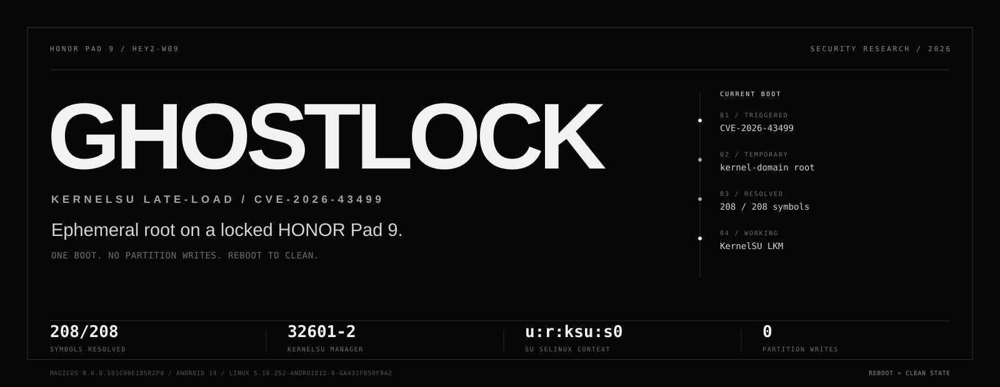
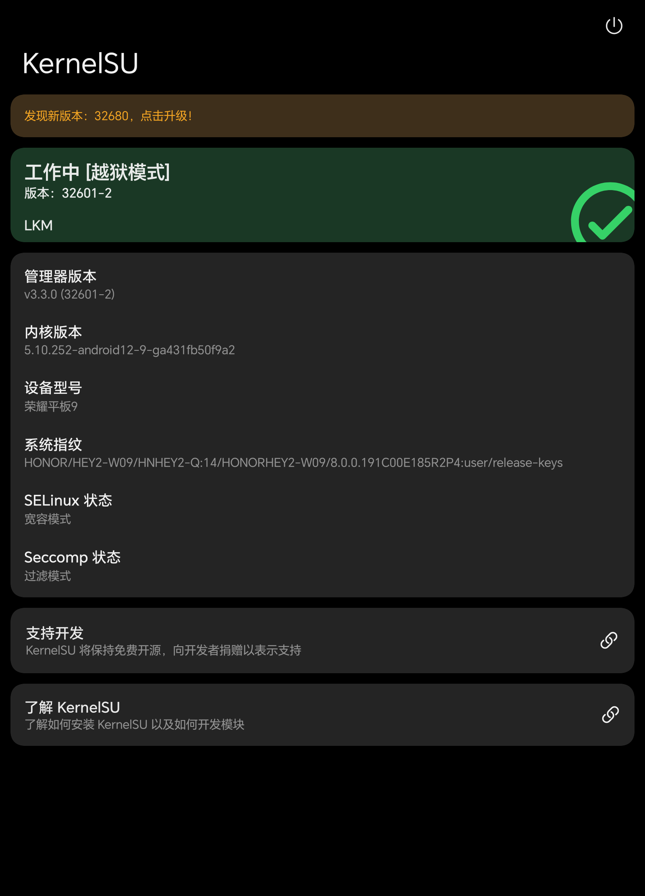
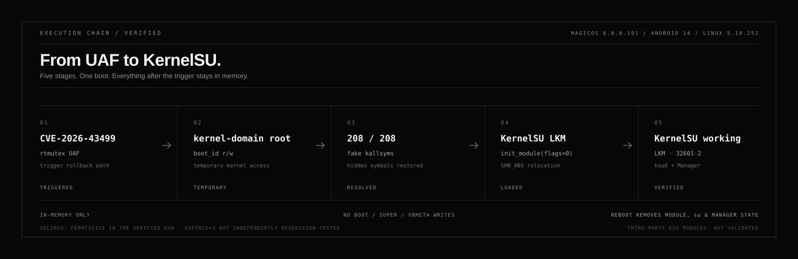

<p align="center">
  <a href="https://github.com/vexpaer/honor-pad9-ghostlock">
    
  </a>
</p>

<h1 align="center">honor-pad9-ghostlock</h1>

<p align="center">
  <b>Ephemeral KernelSU late-load for a locked HONOR Pad 9.</b><br>
  One boot. No partition writes. Reboot to clean.
</p>

<p align="center">
  <a href="docs/VERIFICATION.md"></a>
  <a href="docs/SAFETY.md"></a>
  
  
  <a href="THIRD_PARTY.md"></a>
  <a href="LICENSE"></a>
</p>

<p align="center">
  <b>English</b> · <a href="README.zh-CN.md">简体中文</a> ·
  <a href="docs/VERIFICATION.md">Verification</a> ·
  <a href="docs/OFFSETS.md">Offsets</a> ·
  <a href="docs/SAFETY.md">Safety</a>
</p>

> [!WARNING]
> **Authorized research only.** This is a narrow port for one exact device,
> firmware, and kernel. It is not a bootloader unlock, permanent root, or a
> general-purpose HONOR exploit. Read [Safety](docs/SAFETY.md) before running
> anything, and never test it on a device you do not own or have explicit
> permission to use.

**honor-pad9-ghostlock** is a reproducible security-research port that takes a
locked HONOR Pad 9 from the GhostLock / `CVE-2026-43499` rtmutex UAF to a
working KernelSU stack — without writing `boot`, `super`, `vbmeta`, or any
other partition.

The result is real, but deliberately temporary: KernelSU is late-loaded into
the current boot, `ksud` and the Manager come up, `su` works, and a normal
reboot returns the device to its original state.

---

## At a glance

| | |
|---|---|
| **Verified target** | HONOR Pad 9 `HEY2-W09` / `HNHEY2-Q` · MagicOS `8.0.0.191C00E185R2P4` · Android 14 · Linux `5.10.252-android12-9-ga431fb50f9a2` |
| **Verified result** | KernelSU Manager shows `工作中 [越狱模式]`, `LKM`, version `32601-2`; `su -c id` returns `uid=0(root)` with `u:r:ksu:s0` |
| **Chain** | `CVE-2026-43499` → kernel-domain root → fake kallsyms → `SHN_ABS` relocation → KernelSU LKM → `ksud` + Manager |
| **Lifetime** | Current boot only · reboot removes the module, `su`, and Manager state |
| **Partition writes** | `0` · no boot, super, vbmeta, or other partition was written |
| **Known caveat** | The verified run left SELinux in permissive mode; `Enforce=1` has not been independently regression-tested |

## What this is — and what it is not

| ✅ This project | ⛔ This project is not |
|---|---|
| A source-available, reproducible port for the exact 191 build | A universal exploit for HONOR devices |
| A verified KernelSU late-load into the current boot | A permanent root, bootloader unlock, or persistence layer |
| A hash-pinned workflow for third-party runtime artifacts | A redistributor of `kernelsu.ko`, APKs, or kernel images |
| An evidence-backed research record with explicit limits | A production rooting tool or official KernelSU release |

## Verified target

| Item | Value |
|---|---|
| Device | HONOR Pad 9 `HEY2-W09` / `HNHEY2-Q` |
| Firmware | MagicOS `8.0.0.191C00E185R2P4` |
| Android | 14 |
| Kernel | `5.10.252-android12-9-ga431fb50f9a2` |
| Profile | `honor-HEY2-W09_8.0.0.191` |

The profile is intentionally narrow. The offsets and structure layouts were
measured from the 191 boot image and symbolized kernel; they must not be
reused on another firmware or model.

## Proof, not a promise

<p align="center">
  
</p>

<p align="center">
  <sub>KernelSU Manager on the verified target. The screenshot is cropped to remove
  the status bar, navigation bar, and wireless-network details.</sub>
</p>

The successful run produced the following observable state:

| Check | Observed |
|---|---|
| KernelSU LKM load | `module loaded OK` |
| Undefined symbols | `208/208` resolved |
| `/proc/modules` | `kernelsu` present |
| Manager state | `工作中 [越狱模式]`, `LKM`, `32601-2` |
| `ksud --version` | `ksud 3.3.0 (uapi: 2)` |
| `su -c id` | `uid=0(root)`, SELinux context `u:r:ksu:s0` |
| `ksud post-fs-data` | exit `0` |
| `ksud services` | exit `0` |
| `ksud boot-completed` | exit `0` |
| `ksud install` | exit `0` |
| SELinux after verified run | permissive |

See [docs/VERIFICATION.md](docs/VERIFICATION.md) for the evidence summary and
[docs/OFFSETS.md](docs/OFFSETS.md) for offset provenance and cross-checks.

## The chain

<p align="center">
  
</p>

1. **Trigger** — GhostLock exercises the rtmutex UAF on the futex-requeue-PI
   proxy-lock rollback path.
2. **Kernel access** — the chain reaches kernel-domain root and temporary
   arbitrary kernel read/write through the `boot_id` sysctl entry.
3. **Prepare the module** — credentials are redirected to `init_cred`, the
   module-signature gate is temporarily relaxed, and a fake
   `/proc/kallsyms` restores the symbols hidden by Honor.
4. **Late-load** — `load_ko` resolves the LKM's undefined symbols, rewrites
   them to absolute runtime addresses, and calls `init_module(flags=0)`.
5. **Bring-up** — the loader injects the KernelSU SELinux rules, runs the
   `ksud` stages, and restores the temporary security settings.

The `boot_id` hijack and security changes are not persistent. If an attempt
fails, a reboot is the intended recovery boundary.

## Quick start

### Requirements

- Windows with PowerShell 7 (the tested path), Android platform-tools, and an
  Android NDK — `r28c` or a compatible newer release.
- USB or wireless ADB authorized on the target.
- The exact kernel and build listed above.
- Explicit authorization to test the device.

The repository keeps downloads and compiler temporaries under `bundle/` and
`.cache/` inside the checkout. The scripts do not install dependencies on the
system drive.

### Windows one-click launcher

If the repository and NDK are already on the machine, double-click
[`run-wireless.bat`](run-wireless.bat). It:

- finds `adb`, tries the last wireless target, then discovers
  `_adb-tls-connect._tcp` through mDNS;
- verifies the exact HEY2-W09 kernel and build before offering any action;
- fetches the pinned bundle or builds missing local helpers when needed;
- offers status-only, stage-only, module-only, and full verified modes.

The launcher still asks for an explicit `RUN` confirmation before starting the
exploit. If mDNS discovery fails, it prompts for the `IP:PORT` shown on the
pad's Wireless debugging screen.

### 1. Clone

```powershell
git clone https://github.com/vexpaer/honor-pad9-ghostlock.git
cd honor-pad9-ghostlock
```

### 2. Fetch the pinned runtime bundle

```powershell
pwsh -File .\scripts\fetch-bundle.ps1
```

This downloads the pinned GhostLock-H80GT v0.3.1 archive and the official
KernelSU v3.3.0 Manager APK, verifies their SHA256 values, and extracts only
the files needed by the loader. The binaries land in `bundle/` and are ignored
by git; they are not part of this repository.

### 3. Build the exploit and loaders

```powershell
pwsh -File .\scripts\build.ps1 `
  -NdkRoot '<path-to-android-ndk-r28c>'
```

The build produces `exploit/build/honor-HEY2-W09_8.0.0.191/bin/exploit_static`,
`ksu/load_ko`, and `ksu/kmsg_dumper`. The KernelSU LKM is not built here; it is
the pinned third-party H80GT artifact fetched in the previous step.

### 4. Stage only — do not launch

```powershell
pwsh -File .\scripts\run-ksu.ps1 `
  -Serial '<adb-serial>' `
  -Stages 0 -Enforce 0 -AllowShell 0
```

Without `-Authorize`, the script only stages the files and prints the command
it would run. Use this to inspect the generated loader and the run directory.

### 5. Authorized module-only run

```powershell
pwsh -File .\scripts\run-ksu.ps1 `
  -Serial '<adb-serial>' `
  -Stages 0 -Enforce 0 -AllowShell 0 `
  -Authorize
```

This launches the exploit and stops at module verification. Confirm that
`/proc/modules` contains `kernelsu` before moving on.

### 6. Verified user-space flow

```powershell
pwsh -File .\scripts\run-ksu.ps1 `
  -Serial '<adb-serial>' `
  -Stages 1 -Enforce 0 -AllowShell 1 `
  -InstallManager -Authorize
```

Run this only after the module-only stage succeeds. `-InstallManager` uses
`adb install -r -g`; the verified run kept `Enforce=0`.

> [!IMPORTANT]
> The PowerShell path is the tested one. The Makefile in `exploit/` can build
> on Linux or macOS with a compatible NDK, but that path is not covered by the
> verification record in this repository.

## Limits

- **Late-load only.** Reboot removes the KernelSU module, `su`, and Manager's
  KernelSU state. This is not persistence.
- **One target.** The profile is for MagicOS `8.0.0.191C00E185R2P4` and kernel
  `5.10.252-android12-9-ga431fb50f9a2` only.
- **SELinux boundary.** The verified run left SELinux permissive.
  `Enforce=1` has not been independently regression-tested.
- **No third-party module validation.** KernelSU modules other than the
  late-loaded core stack were not tested.
- **No reliability claim.** The UAF and surrounding timing can fail even on
  the target; a failed attempt can reboot the device.
- **No partition-level rescue.** This repository does not provide a
  bootloader, partition, or recovery workflow.

## Safety

Read [docs/SAFETY.md](docs/SAFETY.md) before running anything. In particular:

- Do not use this on another firmware, another model, or a device you do not
  own.
- Do not unlock or flash the bootloader as part of this procedure.
- Do not write `boot`, `super`, `vbmeta`, `vbmeta_system`, or other partitions.
- Do not add boot-time persistence or an untested module to a first run.
- If ADB disappears, stop. Reboot and re-open wireless debugging instead of
  retrying blindly.
- Do not run unrelated panic PoCs, including the CVE-2026-98260 PoC, while
  validating this chain.

## Repository map

```text
.
├── assets/
│   ├── hero.svg                  project hero
│   ├── chain.svg                 execution-chain diagram
│   └── manager-working.png       cropped on-device proof
├── docs/
│   ├── OFFSETS.md                measured offsets and cross-checks
│   ├── SAFETY.md                 scope, failure modes, recovery
│   └── VERIFICATION.md           observed evidence and limits
├── exploit/
│   ├── Makefile                  non-Windows build path
│   └── src/
│       └── targets/
│           └── honor-HEY2-W09_8.0.0.191/
│               └── target.h      the only public device profile
├── ksu/                          GPL-2.0 loader and policy material
├── run-wireless.bat              double-click Windows launcher
├── scripts/
│   ├── fetch-bundle.ps1          pinned download + SHA256 verification
│   ├── build.ps1                 NDK build for exploit and loaders
│   ├── run-ksu.ps1               authorization-gated ADB workflow
│   └── run-wireless.ps1          wireless discovery and launcher logic
├── NOTICE
├── THIRD_PARTY.md
├── LICENSE                       Apache-2.0
└── README.md
```

`bundle/`, `.cache/`, `exploit/build/`, `ksu/load_ko`, and
`ksu/kmsg_dumper` are generated or downloaded and are intentionally ignored.

## Credits and provenance

This port would not exist without the upstream research and tooling:

| Project | Role |
|---|---|
| [yakidango-official/GhostLock-H80GT](https://github.com/yakidango-official/GhostLock-H80GT) `v0.3.1` | GhostLock port and the pinned H80GT runtime bundle |
| [NebuSec/CyberMeowfia](https://github.com/NebuSec/CyberMeowfia) | IonStack / CVE-2026-43499 research |
| [BuSung-dev/CVE-2026-43499-S25U](https://github.com/BuSung-dev/CVE-2026-43499-S25U) | Additional CVE-2026-43499 research |
| [F-19-F/IonStackQuest3](https://github.com/F-19-F/IonStackQuest3) | Upstream chain work |
| [tiann/KernelSU](https://github.com/tiann/KernelSU) | KernelSU kernel-side material and Manager |
| [topjohnwu/Magisk](https://github.com/topjohnwu/Magisk) | `magiskpolicy` userspace component |

The fetched `kernelsu.ko` is a third-party H80GT build. Its `task_struct`,
`cred`, `mm_struct`, and `ctl_table` layouts match the measured HEY2 191
layout, and all `208` undefined symbol names exist in the HEY2 symbolized
kernel. That is a verified compatibility result for this target — **not** a
claim that KernelSU officially supports `HEY2-W09`.

See [NOTICE](NOTICE) and [THIRD_PARTY.md](THIRD_PARTY.md) for exact commits,
hashes, and licensing.

## License

The exploit and documentation are **Apache-2.0**. The files under `ksu/` are
**GPL-2.0** and derive from KernelSU's kernel-side code. Third-party runtime
artifacts retain their own licenses and are not redistributed by this
repository.

---

<p align="center">
  <sub>Not affiliated with HONOR. KernelSU and Magisk are projects of their respective authors.</sub><br>
  <sub>Research record for one authorized device · 2026-11-05</sub>
</p>
