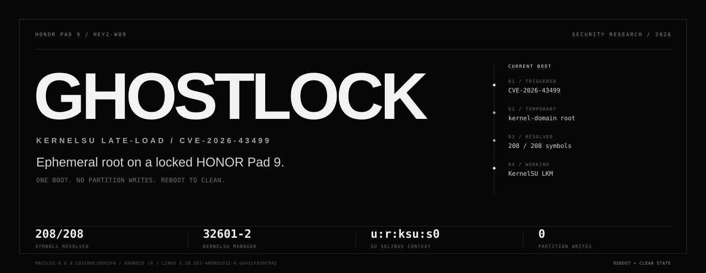
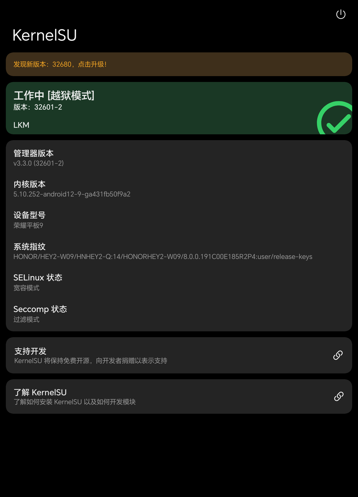
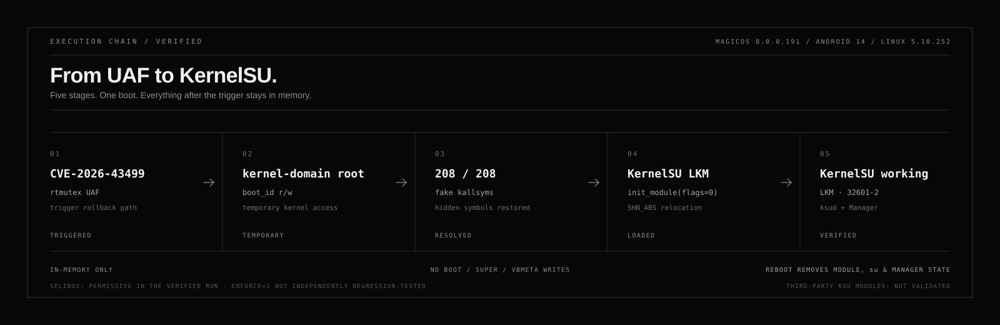

<p align="center">
  <a href="https://github.com/vexpaer/honor-pad9-ghostlock">
    
  </a>
</p>

<h1 align="center">honor-pad9-ghostlock</h1>

<p align="center">
  <b>面向已锁定 HONOR Pad 9 的临时 KernelSU late-load。</b><br>
  只保留一次开机 · 不写任何分区 · 重启即清理。
</p>

<p align="center">
  <a href="docs/VERIFICATION.md"></a>
  <a href="docs/SAFETY.md"></a>
  
  
  <a href="THIRD_PARTY.md"></a>
  <a href="LICENSE"></a>
</p>

<p align="center">
  <a href="README.md">English</a> · <b>简体中文</b> ·
  <a href="docs/VERIFICATION.md">验证记录</a> ·
  <a href="docs/OFFSETS.md">偏移来源</a> ·
  <a href="docs/SAFETY.md">安全说明</a>
</p>

> [!WARNING]
> **仅限获得授权的安全研究。** 本项目只针对一个确定的设备、固件和内核版本。
> 它不是 BL 解锁、不是永久 root，也不是适用于所有 HONOR 设备的通用漏洞利用。
> 运行前请阅读 [安全说明](docs/SAFETY.md)，不要在非本人所有或未获明确授权的设备上测试。

**honor-pad9-ghostlock** 是一个可复现的安全研究移植项目：在已锁定的 HONOR
Pad 9 上，从 GhostLock / `CVE-2026-43499` 的 rtmutex UAF 出发，取得内核域
root，并在当前开机内加载一套可工作的 KernelSU；全程不写 `boot`、`super`、
`vbmeta` 或其他分区。

结果是真实的，但刻意保持临时性：KernelSU 只在本次开机中 late-load，
`ksud` 与 Manager 可以启动，`su` 可以授权；正常重启后设备回到原始状态。

---

## 一眼看懂

| | |
|---|---|
| **已验证目标** | HONOR Pad 9 `HEY2-W09` / `HNHEY2-Q` · MagicOS `8.0.0.191C00E185R2P4` · Android 14 · Linux `5.10.252-android12-9-ga431fb50f9a2` |
| **已验证结果** | KernelSU Manager 显示 `工作中 [越狱模式]`、`LKM`、版本 `32601-2`；`su -c id` 返回 `uid=0(root)`，上下文为 `u:r:ksu:s0` |
| **执行链** | `CVE-2026-43499` → 内核域 root → fake kallsyms → `SHN_ABS` 重定位 → KernelSU LKM → `ksud` + Manager |
| **生命周期** | 仅当前开机 · 重启后模块、`su` 和 Manager 状态消失 |
| **分区写入** | `0` · 未写 boot、super、vbmeta 或其他分区 |
| **已知边界** | 已验证运行保持 SELinux permissive；`Enforce=1` 尚未独立回归测试 |

## 这是什么，不是什么

| ✅ 本项目 | ⛔ 本项目不是 |
|---|---|
| 针对 191 版本、可复现的源码级移植 | 适用于所有 HONOR 设备的通用漏洞利用 |
| 已验证的 KernelSU 当前开机 late-load | 永久 root、BL 解锁或持久化方案 |
| 对第三方运行时文件做哈希固定的工作流 | `kernelsu.ko`、APK 或内核镜像的再分发者 |
| 有证据、有明确边界的公开研究记录 | 生产级 root 工具或官方 KernelSU 版本 |

## 已验证目标

| 项目 | 值 |
|---|---|
| 设备 | HONOR Pad 9 `HEY2-W09` / `HNHEY2-Q` |
| 固件 | MagicOS `8.0.0.191C00E185R2P4` |
| Android | 14 |
| 内核 | `5.10.252-android12-9-ga431fb50f9a2` |
| Profile | `honor-HEY2-W09_8.0.0.191` |

这个 profile 刻意保持狭窄。偏移和结构布局来自 191 boot image 与符号化内核，
不要把它们复用于其他固件或其他型号。

## 证据，而不是承诺

<p align="center">
  
</p>

<p align="center">
  <sub>已验证设备上的 KernelSU Manager。截图已裁掉状态栏、导航栏和无线网络信息。</sub>
</p>

成功运行后观察到：

| 检查项 | 结果 |
|---|---|
| KernelSU LKM 加载 | `module loaded OK` |
| 未定义符号 | `208/208` 全部解析 |
| `/proc/modules` | 出现 `kernelsu` |
| Manager 状态 | `工作中 [越狱模式]`、`LKM`、`32601-2` |
| `ksud --version` | `ksud 3.3.0 (uapi: 2)` |
| `su -c id` | `uid=0(root)`，SELinux 上下文 `u:r:ksu:s0` |
| `ksud post-fs-data` | 退出码 `0` |
| `ksud services` | 退出码 `0` |
| `ksud boot-completed` | 退出码 `0` |
| `ksud install` | 退出码 `0` |
| 验证运行后的 SELinux | permissive |

证据摘要见 [docs/VERIFICATION.md](docs/VERIFICATION.md)，偏移来源与交叉检查见
[docs/OFFSETS.md](docs/OFFSETS.md)。

## 执行链

<p align="center">
  
</p>

1. **触发** — GhostLock 在 futex-requeue-PI proxy-lock 的回滚路径上触发
   rtmutex UAF。
2. **取得内核访问** — 取得内核域 root，并通过 `boot_id` sysctl 入口获得临时
   任意内核读写。
3. **准备模块** — 将凭据指向 `init_cred`，临时放宽模块签名检查，并构造
   fake `/proc/kallsyms` 补齐 Honor 隐藏的符号。
4. **Late-load** — `load_ko` 解析 LKM 的未定义符号，改写为运行时绝对地址，
   调用 `init_module(flags=0)`。
5. **Bring-up** — 注入 KernelSU SELinux 规则，运行 `ksud` 各阶段，并恢复
   临时安全设置。

`boot_id` 劫持和安全设置修改都不会持久化。若运行失败，重启就是预期的恢复
边界。

## 快速开始

### 环境要求

- Windows + PowerShell 7（已验证路径）、Android platform-tools，以及
  Android NDK `r28c` 或兼容的新版本。
- 已授权的 USB 或无线 ADB 连接。
- 精确匹配上表的内核和系统版本。
- 对测试设备的明确授权。

下载和编译临时文件都会留在仓库内的 `bundle/` 与 `.cache/`；脚本不会把依赖
安装到系统盘。

### 1. 克隆

```powershell
git clone https://github.com/vexpaer/honor-pad9-ghostlock.git
cd honor-pad9-ghostlock
```

### 2. 获取并校验固定版本运行时文件

```powershell
pwsh -File .\scripts\fetch-bundle.ps1
```

脚本会下载固定版本的 GhostLock-H80GT v0.3.1 归档和官方 KernelSU v3.3.0
Manager APK，校验 SHA256，并只解出 loader 需要的文件。二进制放在 `bundle/`，
由 git 忽略，不属于仓库内容。

### 3. 编译 exploit 与 loader

```powershell
pwsh -File .\scripts\build.ps1 `
  -NdkRoot '<path-to-android-ndk-r28c>'
```

构建产物包括
`exploit/build/honor-HEY2-W09_8.0.0.191/bin/exploit_static`、
`ksu/load_ko` 和 `ksu/kmsg_dumper`。这里不会从零构建 KernelSU LKM；LKM 是
上一步获取并校验的第三方 H80GT 固定产物。

### 4. 只部署，不启动

```powershell
pwsh -File .\scripts\run-ksu.ps1 `
  -Serial '<adb-serial>' `
  -Stages 0 -Enforce 0 -AllowShell 0
```

不传 `-Authorize` 时，脚本只部署文件并打印将要执行的命令，不会启动 exploit。
建议先检查生成的 loader 和运行目录。

### 5. 获得授权后，仅验证模块加载

```powershell
pwsh -File .\scripts\run-ksu.ps1 `
  -Serial '<adb-serial>' `
  -Stages 0 -Enforce 0 -AllowShell 0 `
  -Authorize
```

这一步会启动 exploit，但只验证模块加载。确认 `/proc/modules` 中出现
`kernelsu` 后再继续。

### 6. 已验证的用户态流程

```powershell
pwsh -File .\scripts\run-ksu.ps1 `
  -Serial '<adb-serial>' `
  -Stages 1 -Enforce 0 -AllowShell 1 `
  -InstallManager -Authorize
```

只应在模块加载阶段成功后运行。`-InstallManager` 使用 `adb install -r -g`；
已验证流程保持 `Enforce=0`。

> [!IMPORTANT]
> PowerShell 是已验证路径。`exploit/` 下的 Makefile 可用于 Linux 或 macOS
> 配合兼容 NDK 构建，但该路径不在本仓库的验证记录内。

## 边界

- **仅限 late-load。** 重启后 KernelSU 模块、`su` 和 Manager 的 KernelSU
  状态都会消失；这不是持久化。
- **只针对一个目标。** 仅适用于 MagicOS `8.0.0.191C00E185R2P4` 和内核
  `5.10.252-android12-9-ga431fb50f9a2`。
- **SELinux 边界。** 已验证运行保持 permissive；`Enforce=1` 尚未独立回归。
- **未验证第三方模块。** 除 late-load 的核心栈外，其他 KernelSU 模块未测试。
- **不承诺稳定性。** UAF 及其时序即使在目标设备上也可能失败；失败可能导致
  一次重启。
- **不提供分区级救援。** 本仓库不包含 BL、分区或 recovery 救援流程。

## 安全

运行前请阅读 [docs/SAFETY.md](docs/SAFETY.md)。尤其注意：

- 不要在另一版本固件、另一型号或非本人所有的设备上使用。
- 不要把 BL 解锁或刷机作为本流程的一部分。
- 不要写 `boot`、`super`、`vbmeta`、`vbmeta_system` 或其他分区。
- 不要在第一次运行中加入开机持久化或未验证模块。
- ADB 消失时立即停止；重启并重新打开无线调试，不要盲目重试。
- 验证本链时不要运行无关的 panic PoC，包括 CVE-2026-98260 PoC。

## 仓库结构

```text
.
├── assets/
│   ├── hero.svg                  项目首屏
│   ├── chain.svg                 执行链图
│   └── manager-working.png       裁剪后的设备证据
├── docs/
│   ├── OFFSETS.md                偏移与交叉检查
│   ├── SAFETY.md                 范围、失败模式与恢复
│   └── VERIFICATION.md           实测证据与边界
├── exploit/
│   ├── Makefile                  非 Windows 构建路径
│   └── src/
│       └── targets/
│           └── honor-HEY2-W09_8.0.0.191/
│               └── target.h      唯一公开设备 profile
├── ksu/                          GPL-2.0 loader 与策略材料
├── scripts/
│   ├── fetch-bundle.ps1          固定版本下载与 SHA256 校验
│   ├── build.ps1                 exploit 与 loader 的 NDK 构建
│   └── run-ksu.ps1               带授权门的 ADB 工作流
├── NOTICE
├── THIRD_PARTY.md
├── LICENSE                       Apache-2.0
└── README.md
```

`bundle/`、`.cache/`、`exploit/build/`、`ksu/load_ko` 和
`ksu/kmsg_dumper` 都是生成或下载内容，已由 git 忽略。

## 致谢与来源

这个移植建立在上游研究和工作流之上：

| 项目 | 作用 |
|---|---|
| [yakidango-official/GhostLock-H80GT](https://github.com/yakidango-official/GhostLock-H80GT) `v0.3.1` | GhostLock 移植与固定版本 H80GT 运行时包 |
| [NebuSec/CyberMeowfia](https://github.com/NebuSec/CyberMeowfia) | IonStack / CVE-2026-43499 研究 |
| [BuSung-dev/CVE-2026-43499-S25U](https://github.com/BuSung-dev/CVE-2026-43499-S25U) | CVE-2026-43499 相关研究 |
| [F-19-F/IonStackQuest3](https://github.com/F-19-F/IonStackQuest3) | 上游链工作 |
| [tiann/KernelSU](https://github.com/tiann/KernelSU) | KernelSU 内核侧材料与 Manager |
| [topjohnwu/Magisk](https://github.com/topjohnwu/Magisk) | `magiskpolicy` 用户态组件 |

获取的 `kernelsu.ko` 是第三方 H80GT 构建。它的 `task_struct`、`cred`、
`mm_struct` 与 `ctl_table` 布局与实测 HEY2 191 布局一致，`208` 个未定义
符号名也都存在于 HEY2 符号化内核中。这是针对本目标的兼容性验证结果，
**不代表** KernelSU 官方支持 `HEY2-W09`。

精确 commit、哈希和许可证见 [NOTICE](NOTICE) 与
[THIRD_PARTY.md](THIRD_PARTY.md)。

## 许可证

`exploit/` 与文档采用 **Apache-2.0**。`ksu/` 下的文件采用 **GPL-2.0**，
并源自 KernelSU 的内核侧代码。第三方运行时文件保留各自许可证，本仓库不再
分发它们。

---

<p align="center">
  <sub>与 HONOR 无关联。KernelSU 与 Magisk 属于各自作者。</sub><br>
  <sub>单一授权设备的研究记录 · 2026-11-05</sub>
</p>
